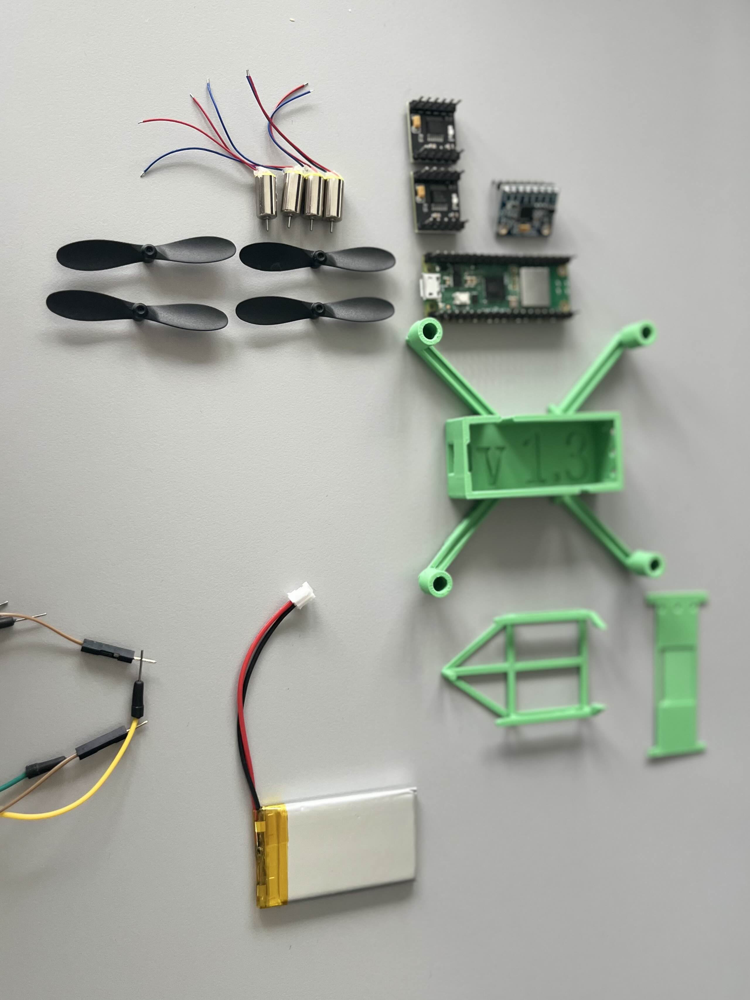
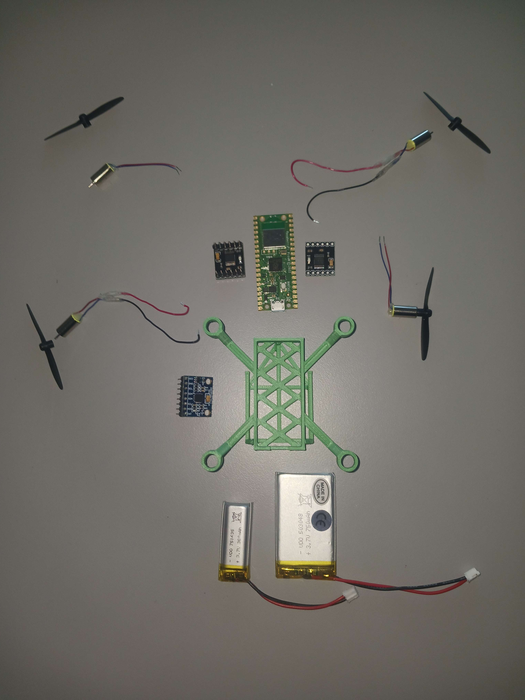

# Components

## Prototype Alpha (1st gen)

|Role|Component|Datasheet-link|Buy-link|Price/piece|Weight|Additional info|
|---|---|---|---|---|---|---|
|MCU|Raspberry Pi Pico W|[Official datasheet](https://www.electrokit.com/upload/quick/be/e6/a561_41019110-TDS.pdf)|[Electrokit.com](https://www.electrokit.com/raspberry-pi-pico-w?gad_source=1&gad_campaignid=153209425&gclid=Cj0KCQiAnJHMBhDAARIsABr7b8556yHT6rHeilzyw0AEcDgZTu2Ot9haIAusKaWPouvxGXiiCocpS5AaArjxEALw_wcB)|88,00 SEK|4g||
|ESC|2 * DRV8833|[Chip datasheet](https://www.ti.com/lit/ds/symlink/drv8833.pdf?ts=1770311029640&ref_url=https%253A%252F%252Fwww.ti.com%252Fproduct%252FDRV8833%253Futm_source%253Dgoogle%2526utm_medium%253Dcpc%2526utm_campaign%253Dasc-mdbu-null-44700045336317506_prodfolderdynamic-cpc-pf-google-eu_en_int%2526utm_content%253Dprodfolddynamic%2526ds_k%253DDYNAMIC+SEARCH+ADS%2526gclsrc%253Daw.ds%2526gad_source%253D1%2526gad_campaignid%253D8754268539%2526gclid%253DCj0KCQiAnJHMBhDAARIsABr7b85RrzfuiPEmjFqteXFpgLYBDEZccf5HGofydHTC7LBGfW1yLVgHJY0aAg76EALw_wcB)|[Amazon.se](https://www.amazon.se/gp/product/B0DHRFRG6X?ref=ppx_pt2_dt_b_prod_image)|12,48 SEK|1g|dual channel|
|IMU|MPU6050|[datasheet](https://www.electrokit.com/upload/quick/48/20/fa00_41016233-tds.pdf)|[Electrokit.com](https://www.electrokit.com/en/mpu-6050-accelerometer-3-axel-gyro-monterad-pa-kort)|65,00 SEK|2g|weight w header|
|Motor|DC-motor 3.7V 50000rpm med fläktblad|[unofficial datasheet](https://components101.com/sites/default/files/component_datasheet/Coreless-DC-Drone-Motor-Datasheet.pdf)|[Electrokit.com](https://www.electrokit.com/dc-motor-3.7v-50000rpm-med-flaktblad)|39,00 SEK|2g|weight w propeller|
|Battery|VDO503048 3.7V 750mAh|n/a|[Electrokit.com](https://www.electrokit.com/en/batteri-lipo-3.7v-750mah)|129,00 SEK|16g||
|Chassis|Prototype v1.3|[.stl model](./chassi_revisions/Alpha%20v1_3.stl)|designed ourselves|3d printed|~17g|excluding support|
|Wiring & headers|n/a|n/a|n/a|n/a|n/a|never installed|

## Prototype Beta (2nd gen)

|Role|Component|Datasheet-link|Buy-link|Price/piece|Weight|Additional info|
|---|---|---|---|---|---|---|
|MCU|Raspberry Pi Pico W|[Official datasheet](https://www.electrokit.com/upload/quick/be/e6/a561_41019110-TDS.pdf)|[Electrokit.com](https://www.electrokit.com/raspberry-pi-pico-w?gad_source=1&gad_campaignid=153209425&gclid=Cj0KCQiAnJHMBhDAARIsABr7b8556yHT6rHeilzyw0AEcDgZTu2Ot9haIAusKaWPouvxGXiiCocpS5AaArjxEALw_wcB)|88,00 SEK|4g||
|ESC|2 * DRV8833|[Chip datasheet](https://www.ti.com/lit/ds/symlink/drv8833.pdf?ts=1770311029640&ref_url=https%253A%252F%252Fwww.ti.com%252Fproduct%252FDRV8833%253Futm_source%253Dgoogle%2526utm_medium%253Dcpc%2526utm_campaign%253Dasc-mdbu-null-44700045336317506_prodfolderdynamic-cpc-pf-google-eu_en_int%2526utm_content%253Dprodfolddynamic%2526ds_k%253DDYNAMIC+SEARCH+ADS%2526gclsrc%253Daw.ds%2526gad_source%253D1%2526gad_campaignid%253D8754268539%2526gclid%253DCj0KCQiAnJHMBhDAARIsABr7b85RrzfuiPEmjFqteXFpgLYBDEZccf5HGofydHTC7LBGfW1yLVgHJY0aAg76EALw_wcB)|[Amazon.se](https://www.amazon.se/gp/product/B0DHRFRG6X?ref=ppx_pt2_dt_b_prod_image)|12,48 SEK|1g|dual channel, weight w/o headers|
|IMU|MPU6050|[datasheet](https://www.electrokit.com/upload/quick/48/20/fa00_41016233-tds.pdf)|[Electrokit.com](https://www.electrokit.com/en/mpu-6050-accelerometer-3-axel-gyro-monterad-pa-kort)|65,00 SEK|(2g)|never wired|
|Motor|DC-motor 3.7V 50000rpm med fläktblad|[unofficial datasheet](https://components101.com/sites/default/files/component_datasheet/Coreless-DC-Drone-Motor-Datasheet.pdf)|[Electrokit.com](https://www.electrokit.com/dc-motor-3.7v-50000rpm-med-flaktblad)|39,00 SEK|2g|weight w propeller|
|Battery|VDO503048 3.7V 750mAh|n/a|[Electrokit.com](https://www.electrokit.com/en/batteri-lipo-3.7v-750mah)|129,00 SEK|16g||
|Chassis|Prototype v2.3|.stl [body](./chassi_revisions/Beta%20v2_3%20body.stl), [cage](./chassi_revisions/Beta%20v2_1%20bat_cage.stl), [lid](./chassi_revisions/Beta%20v2_2%20lid.stl)|designed ourselves|3d printed|~15g|body + battery cage + lid|

|Wiring & headers|n/a|n/a|n/a|n/a|n/a|never installed|

Total weight (assembled): 53g
Sum weight connected to laptop prev to power: 55g
Max thrust down w power: 61g
est. thrust; 61-55 = 6g

est. single-motor thrust; 2g

## Prototype Gamma (3rd gen)

|Role|Component|Datasheet-link|Buy-link|Price/piece|Weight|Additional info|
|---|---|---|---|---|---|---|
|MCU|Raspberry Pi Pico W|[Official datasheet](https://www.electrokit.com/upload/quick/be/e6/a561_41019110-TDS.pdf)|[Electrokit.com](https://www.electrokit.com/raspberry-pi-pico-w?gad_source=1&gad_campaignid=153209425&gclid=Cj0KCQiAnJHMBhDAARIsABr7b8556yHT6rHeilzyw0AEcDgZTu2Ot9haIAusKaWPouvxGXiiCocpS5AaArjxEALw_wcB)|88,00 SEK|4g|(w/o headers)|
|ESC|2 * DRV8833|[Chip datasheet](https://www.ti.com/lit/ds/symlink/drv8833.pdf?ts=1770311029640&ref_url=https%253A%252F%252Fwww.ti.com%252Fproduct%252FDRV8833%253Futm_source%253Dgoogle%2526utm_medium%253Dcpc%2526utm_campaign%253Dasc-mdbu-null-44700045336317506_prodfolderdynamic-cpc-pf-google-eu_en_int%2526utm_content%253Dprodfolddynamic%2526ds_k%253DDYNAMIC+SEARCH+ADS%2526gclsrc%253Daw.ds%2526gad_source%253D1%2526gad_campaignid%253D8754268539%2526gclid%253DCj0KCQiAnJHMBhDAARIsABr7b85RrzfuiPEmjFqteXFpgLYBDEZccf5HGofydHTC7LBGfW1yLVgHJY0aAg76EALw_wcB)|[Amazon.se](https://www.amazon.se/gp/product/B0DHRFRG6X?ref=ppx_pt2_dt_b_prod_image)|12,48 SEK|1g|dual channel, weight w/o headers|
|IMU|MPU6050|[datasheet](https://www.electrokit.com/upload/quick/48/20/fa00_41016233-tds.pdf)|[Electrokit.com](https://www.electrokit.com/en/mpu-6050-accelerometer-3-axel-gyro-monterad-pa-kort)|65,00 SEK|(2g)|never wired|
|Motor|4 * DC-motor 3.7V 50000rpm med fläktblad|[unofficial datasheet](https://components101.com/sites/default/files/component_datasheet/Coreless-DC-Drone-Motor-Datasheet.pdf)|[Electrokit.com](https://www.electrokit.com/dc-motor-3.7v-50000rpm-med-flaktblad)|39,00 SEK|2g|weight w propeller|
|Battery|VDO503048 3.7V 750mAh|n/a|[Electrokit.com](https://www.electrokit.com/en/batteri-lipo-3.7v-750mah)|129,00 SEK|16g||
|Chassis|Prototype v3.1|.stl [body](./chassi_revisions/Gamma%20v3_1%20body.stl), [cage](./chassi_revisions/Beta%20v2_1%20bat_cage.stl)|designed ourselves|3d printed|6g|body + battery cage|
|Wiring & headers|n/a|n/a|n/a|n/a|~0g||

## Other

Battery Charger: [*MCP73833*](https://www.electrokit.com/usb-ulipo-laddare-for-lipo-batterier); [wiring diagram](https://www.electrokit.com/upload/product/41010/41010264/USB-uLIPO-REV-B.pdf)
