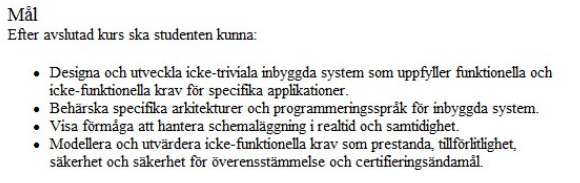

# Temporär titel

## Tekniker & Mål

* Komplexiteten hos en drönare kommer tvinga oss att utveckla och arbeta med ett flertal sensorer och pådrivare samtidigt. Kravspecificeringen kommer formuleras i början av projektet utifrån både konsumenters, och våra egna appliceringsönskemål, och är i och med drönares natur även mycket begränsade av hårdvaran (lyftkraft, stabilitet, vikt, kommunikationsräckvidd, etc).

* RPI Pico har gott stöd även för språk på högre nivå, så vi planerar att preliminärt skriva mjukvarusidan i mikropython. Ifall detta visar sig för beräkningsmässigt krävande kan vi dock tvingas övergå till att arbeta i C.

* Styrningen av en drönare kommer i högsta grad kräva schemaläggning och simultanhantering av ett flertal komponenter (om inte annat motorerna).

* Kommer ingå i vår kravspecifikation.

Punkter från kurskrav bifogade nedan.

## Planering

Direkt tagen från [Project Proposal v1](../Project%20proposal%20nc222iw,%20sa225hh-v1.pdf)

### 3 Planning – Milestones and deadlines

*A preliminary schedule for the project.*

#### Drone

Noa focus on hardware + report, Samuel focus cad + software + calculations

#### Week 5:  Connect to one electrical motor, and set up working repo

 Milestone 1: One propeller works

#### Week 6:  Define list of hardware, design drone case/arms in CAD

 Milestone 2: Give it a body

#### Week 7:  Connect to all 4 motors, and mount in/on body (prototype assembly)

 Milestone 3: Assembled prototype

#### Week 8:  Test carrying capacity, drone case redesigns

 Milestone 4: It flies!

#### Week 9:  Test stabilisation/control + knockover tests

 Milestone 5: It flies where we want it to!

#### Week 10:  Testing landing + operating time (power draw) + margin

 Milestone 6: We know how long it flies, and where to.

#### Week 11:  Draft report, gather additional sources

 Milestone 7: Report written

#### Week 12:  Make build list (costs), finish report

 Milestone 8: Instruction manual/instructions done

 Milestone 9: Report polished, ready for hand-in.

## Feedback

* Få in distansstyrningen (bluetooth?, är supported på pico w)
* Loggbok!
* Skriva till lite fler skogsbolag
* Daniel utreder om vi kan få skriva samma projekt åt fakulteten
* Fråga Hampus om att skicka iväg vår labb-access ansökan
