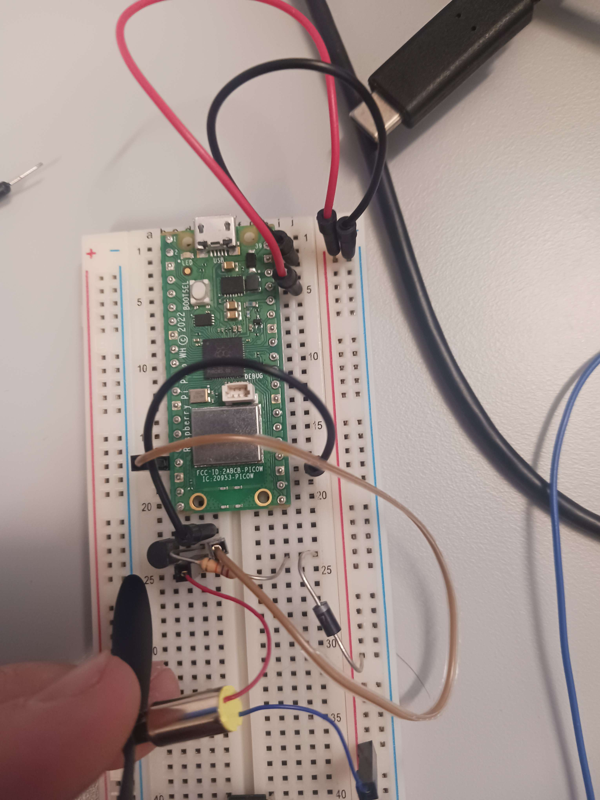

# *Milestone* Experiment 1.2

## What was accomplished?

We cleared Milestone 1 ***"One propeller works**: Connect to one electrical motor, and set up working repo"*, the goal for the first week of work, w5 2026.

## How did we accomplish it?

We connected one of the smaller, final motors to the same circuit used in Test 1.1, hoping that it would power on and off. So it did, and we proceeded by also gluing on one of the propellars to get a feel for the thrust. For further experimentation DRV8833 motor-controllers have been ordered. We did notice that it only switched between two seemingly fixed modes; on and off. Further testing needed.

## How does it help us?

We now know that the motors can indeed be controlled directly by the Raspberry Pi Pico w with this type of flyback diode design.
It also indicates that glue might be strong enough to affix the propellers to the motor shaft.

We also know that for being able to steer the drone, a voltage regulator of some sort will be required. Due to time limitations, and build complexity we are not trying to design our own motor controller, and instead going to do further testing with the DRV8833.

## What did we learn?

A motor controller is not needed for turning on or off a motor connected to the RPI Pico *(but will probably be needed for running multiple motors concurrently)*.

Without a motor controlled the rpm of a motor cannot be adjusted *(a very large issue, since this is how the drone will be steered)*.

## Images, Diagrams and Appendices

[Test 1.2 code](https://gitlab.lnu.se/nc222iw/droneproject/-/blob/fd379aef5c7bed13afe947839421911ce46b6f24/src/tests/test1/Dc_motor.py)

```python
from machine import Pin, PWM
from time import sleep

motor_pwm = PWM(Pin(13))
motor_pwm.freq(20000)


try:
    while True:
        for freq in range(0, 65535, 2000):
            motor_pwm.duty_u16(freq)
            print("+", freq)
            sleep(0.1)
        
        print("Motor max duty")
        sleep(30000)
        
        for freq in range(65535, 0, -2000):
            motor_pwm.duty_u16(freq)
            print("-", freq)
            sleep(0.1)
        
        print("Motor min duty")
        sleep(3)
finally:
        motor_pwm.duty_u16(0)
        motor_pwm.deinit()
        print("Motor OFF")
```

Result: This loop intended to speed up, and then slow down the motor again to test the rpm range, seemed to instead simply turn the motor on and off. We suspect a certain duty value acts as a threashold, bypassing the diode, and allowing current to reach the motor.


Overview of board state with motor connected
