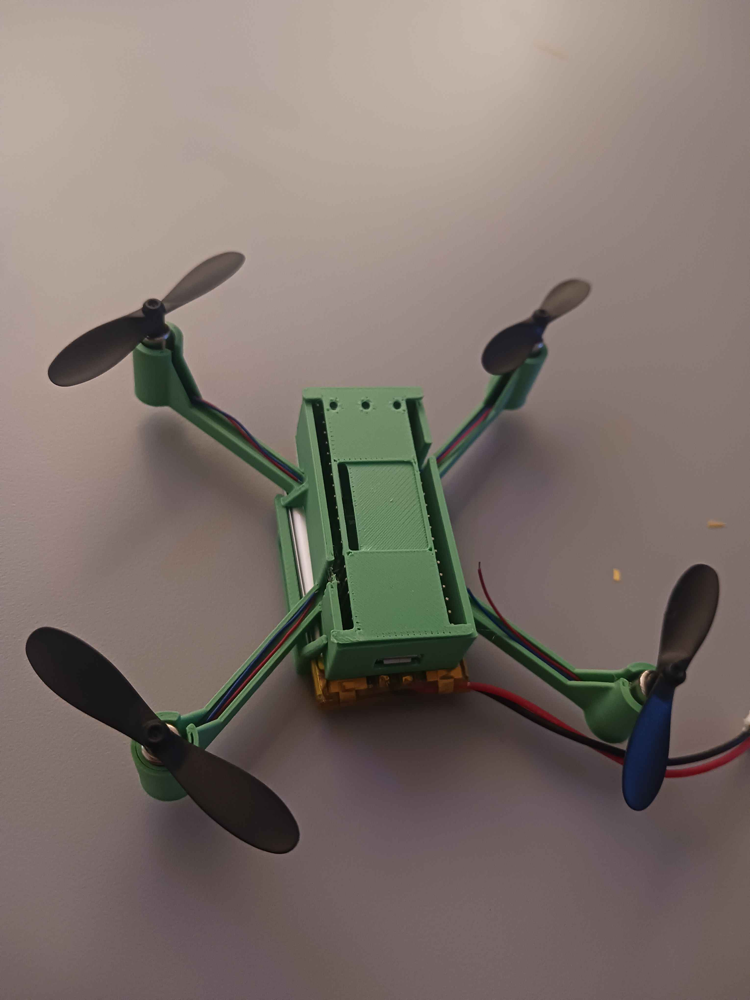

# *Milestone* Components and Chassis

## What was accomplished?

We cleared Milestone 2 ***"Give it a body**: Define list of hardware, design drone case/arms in CAD"*, the goal for the second week of work, w6 2026.

## How did we accomplish it?

By gathering a proper [list of all the components](../components.md), with accompanying images, datasheets (where applicable), and the list of our purchases of components we satisfied the first part. For the second section -chassis-, a series of versions were designed in TinkerCAD, each an improvement upon the previous option. All gathered in `/drone/doc/chassi_revisions`, they can be viewed and downloaded if there would be interest to do so. But, from trying to print the first prototype, we encountered printing issues prolonging the process by a week. We opted for postponing the milestone completion until these issues had been resolved, and a functioning set of printer setting been found.

The final method proved to be changing printer from the **BambooLabs X1 Carbon** to instead use the **Prusa Mini**, with a slower speed, and close to default settings.

## How does it help us?

By now having found functioning 3d-printer settings, we can continue iterating through tangible and testable chassis designs, and actually start optimizing weight, structural capacity and costs.

## What did we learn?

That the **BambooLabs X1 Carbon** printer in the iotlab here in Kalmar seems to be damaged, and that we should have tried another one a while ago. Quite a number of quirks with the chassis have also been resolved, reducing weight further, optimizing printability by simplifying the shape, enchancing the usability by using proper measurements and margins for the hardware, and some material testing by finding out that glossy PLA seems to be much more brittle than matte PLA.

## Images, Diagrams and Appendices

### Components List

Motor: ["DC-motor 3.7V 50000rpm med fläktblad"](https://www.electrokit.com/dc-motor-3.7v-50000rpm-med-flaktblad); [est data sheet](https://components101.com/sites/default/files/component_datasheet/Coreless-DC-Drone-Motor-Datasheet.pdf)

Propellers: provided with [motors](https://www.electrokit.com/dc-motor-3.7v-50000rpm-med-flaktblad) per above

Motor controller: [DRV8833](https://www.amazon.se/gp/product/B0DHRFRG6X?ref=ppx_pt2_dt_b_prod_image); [datasheet](https://www.ti.com/lit/ds/symlink/drv8833.pdf?ts=1770311029640&ref_url=https%253A%252F%252Fwww.ti.com%252Fproduct%252FDRV8833%253Futm_source%253Dgoogle%2526utm_medium%253Dcpc%2526utm_campaign%253Dasc-mdbu-null-44700045336317506_prodfolderdynamic-cpc-pf-google-eu_en_int%2526utm_content%253Dprodfolddynamic%2526ds_k%253DDYNAMIC+SEARCH+ADS%2526gclsrc%253Daw.ds%2526gad_source%253D1%2526gad_campaignid%253D8754268539%2526gclid%253DCj0KCQiAnJHMBhDAARIsABr7b85RrzfuiPEmjFqteXFpgLYBDEZccf5HGofydHTC7LBGfW1yLVgHJY0aAg76EALw_wcB)

MCU: [Raspberry Pi Pico W](https://www.electrokit.com/raspberry-pi-pico-w?gad_source=1&gad_campaignid=153209425&gclid=Cj0KCQiAnJHMBhDAARIsABr7b8556yHT6rHeilzyw0AEcDgZTu2Ot9haIAusKaWPouvxGXiiCocpS5AaArjxEALw_wcB); [data sheet](https://www.electrokit.com/upload/quick/be/e6/a561_41019110-TDS.pdf)

IMU: [MPU1650](https://www.electrokit.com/en/mpu-6050-accelerometer-3-axel-gyro-monterad-pa-kort); [datasheet](https://www.electrokit.com/upload/quick/48/20/fa00_41016233-tds.pdf)

Battery: [VDO503048 3.7V 750mAh](https://www.electrokit.com/en/batteri-lipo-3.7v-750mah)

Battery Charger: [*MCP73833*](https://www.electrokit.com/usb-ulipo-laddare-for-lipo-batterier); [wiring diagram](https://www.electrokit.com/upload/product/41010/41010264/USB-uLIPO-REV-B.pdf)

Chassis: PLA printed, TinkerCAD designs: `drone/doc/chassi_revisions/`

### Chassis Prototype Beta v2.3

v2.3 body with hardware, v1.3 lid, and v1.3 battery cage
