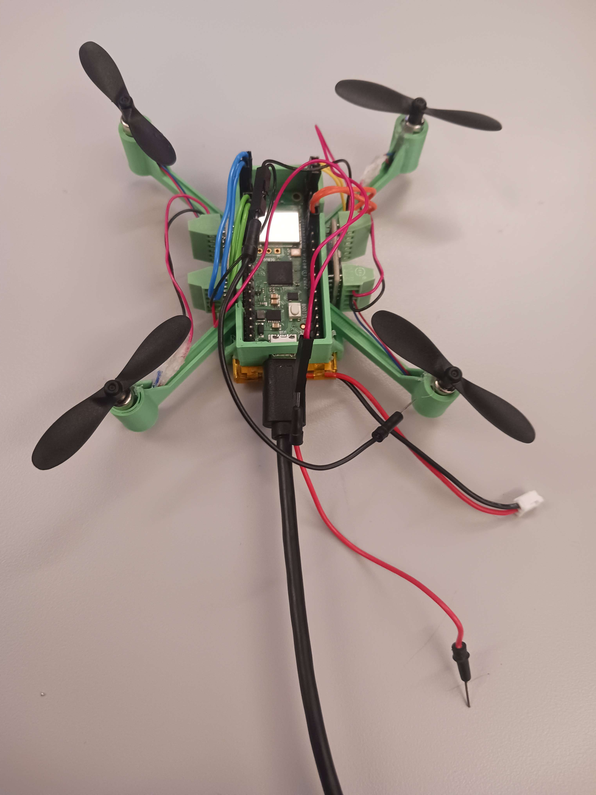
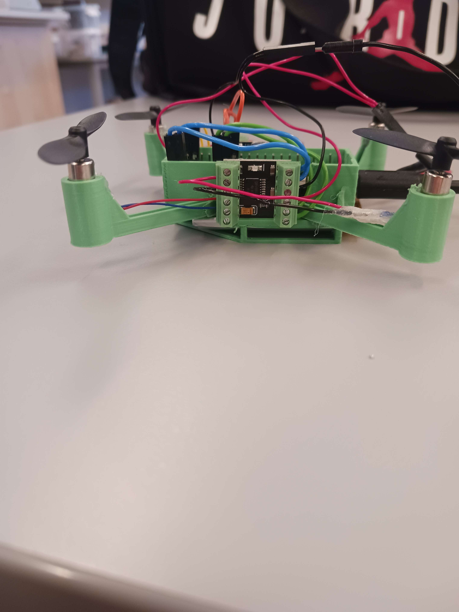
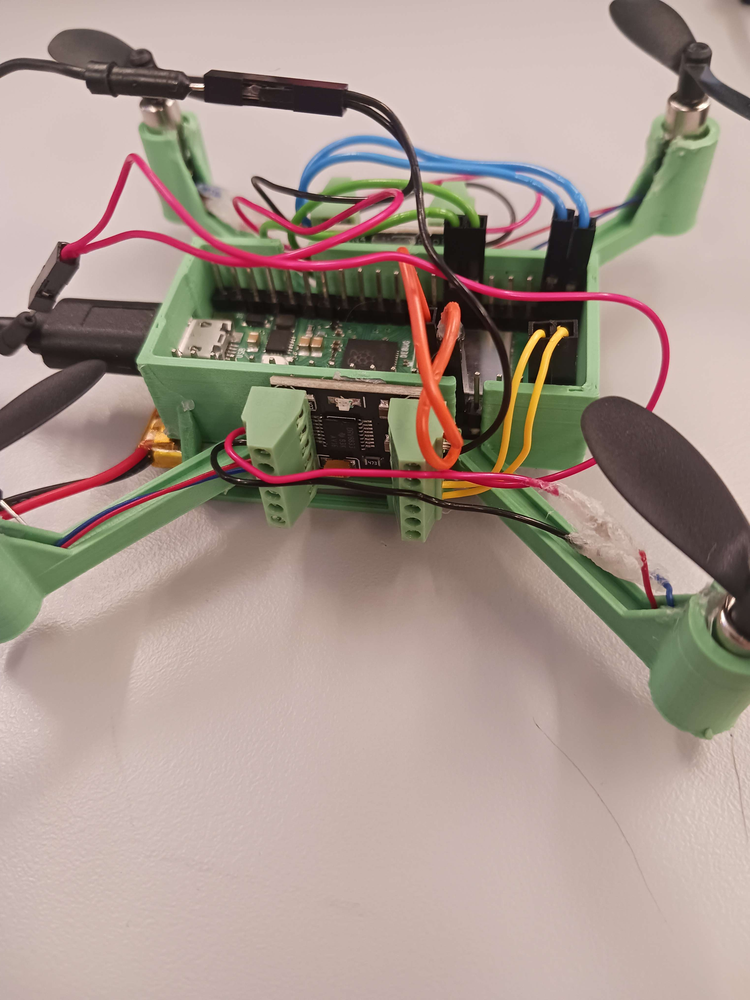

# *Milestone* Prototype Assembly

## What was accomplished?

We cleared Milestone 3 ***"Assembled prototype**: Connect to all 4 motors, and mount in/on body (prototype assembly)"*, the goal for the third week of work, w7 2026.

## How did we accomplish it?

In the Chassis Beta v2.3 Prototype successfully printed recently, we assembled the motors, MCU and motor drivers. For an improved component fit, and increased flexibility, we soldered A Raspberry Pi Pico W with upside-down headers, same with two DRV8833. This allowed us to still have the cipsets turned up/out, even when having access to the header rails. When starting the wiring of the motors and connecting up the DRV8833's to the RPI Pico W, we switched the DRV8833 headers for screw terminals to ease wirings. Since no accessible breadboard cables were good enough, we then soldered our own. In total 10 m-f wires, among two split ones for ground and power, and two of the motors had their wires extended *(see figures below)*. This took the better part of two days.
When everything was wired up, we started experimenting with starting the motors, realizing that the RPI Pico W VBUS pin 40 was too weak to power all four motors at the same time. We then connected the circuit to the battery (3.7V) instead. This more stable power supply (though lower voltage) allowed us to get all four propellers running simultaneously *(although no lift-off was achieved)*.

## How does it help us?

We have now confirmed that all four motors can be individually controlled via the RPI Pico W and DRV8833's, and that they do in fact provide upwards thrust *(if properly directed)*. It also showed us a series of details needed for continuing on the project. Among those the need for higher thrust, lower total weight, and upgrade in terms of battery.

## What did we learn?

### Weight

The total weight needs to be reduced, and can reasonably be done by;

* Redesigning the chassis *(less plastic = less weight)*
* Improving the cable management *(shorter wires = less weight)*
* Soldering directly onto the chips themselves, removing need for headers *(headers are heavy)*

### Thrust & Power

We currently have too low thrust from our motors. Before buying other, stronger motors;

* One of the current ones seems to be slightly damaged *(to be tested further)*
* We may not provide them with enough current *(code caps the system at 90% capacity, and that is further bottlenecked by the lackluster voltage from our battery)*

We might need new propellers, since all of ours are identical. This will prove to be an issue if all four are going to provide downwards thrust, but not all rotate the same direction *(two propellers should be mirrored due to drone stabilisation mechanics)*.

We need to fix our voltage supply problem, and look for stronger batteries, able to fully power all four motors.

### Other

The drone wiring layout needs to be reworked for future prototypes.

## Images, Diagrams and Appendices

[Prototype test code](https://gitlab.lnu.se/nc222iw/droneproject/-/blob/fb2b3c56c2bc3d30ba4254f97f877819d09280c3/src/tests/drv8833_test.py)

```python
from machine import Pin, PWM
from drv8833 import DRV8833 # ../lib/drv8833.py
from time import sleep

Pin("LED").on()
sleep(1)
Pin("LED").off()

# NOTE: feel free to play with the frequency value! The frequency (how many PWM cycles per second
# sent to the DRV pins) changes the behavior of the connected motors, especially at low throttle
# values. (based on very brief testing) We recommend values no lower than 1,000 and no higher than
# 200,000. 40,000 is a good default.
frequency = 40_000

# Make sure to set the correct pins!
r_a_in1 = PWM(Pin(15, Pin.OUT))
r_a_in2 = PWM(Pin(14, Pin.OUT))
r_a_in1.freq(frequency)
r_a_in2.freq(frequency)

r_b_in1 = PWM(Pin(11, Pin.OUT))
r_b_in2 = PWM(Pin(10, Pin.OUT))
r_b_in1.freq(frequency)
r_b_in2.freq(frequency)

l_a_in1 = PWM(Pin(17, Pin.OUT))
l_a_in2 = PWM(Pin(16, Pin.OUT))
l_a_in1.freq(frequency)
l_a_in2.freq(frequency)

l_b_in1 = PWM(Pin(21, Pin.OUT))
l_b_in2 = PWM(Pin(20, Pin.OUT))
l_b_in1.freq(frequency)
l_b_in2.freq(frequency)

drv_left = DRV8833(l_a_in1, l_a_in2, l_b_in1, l_b_in2) 
drv_right = DRV8833(r_a_in1, r_a_in2, r_b_in1, r_b_in2)


MAX_THROTTLE = 0.9  # maximum throttle
var = 0
oth = MAX_THROTTLE

try:
    while True:
        while (var < MAX_THROTTLE):
            var+=0.05
            drv_left.throttle_a(var)
            drv_left.throttle_b(var)
            drv_right.throttle_a(var)
            drv_right.throttle_b(var)
            
            sleep(0.5)  # small delay to avoid busy looping
            print("Speed:", var)
        
        sleep(4.0)
        
        while (oth > 0):
            oth -= 0.05
            
            drv_left.throttle_a(oth)
            drv_left.throttle_b(oth)
            drv_right.throttle_a(oth)
            drv_right.throttle_b(oth)
            sleep(0.5)
            print("Speed:", oth)
        
        var=0
        oth=MAX_THROTTLE

except KeyboardInterrupt:
    drv_right.stop_a()
    drv_right.stop_b()
    drv_left.stop_a()
    drv_left.stop_b()
    
    drv_right.deinit()
    drv_left.deinit()
```

Result: This loop intended to speed up, and then slow down the motors again to test the rpm range. It functioned as expected based on the provided current. Using comments to isolate one motor at a time, it could be proven to function properly even with the RPI Pico W as a power source.


Overview of board state with prototype Beta connected

Blue wires = Right Side A (bottom left)

Green wires = Right Side B (top left)

Orange wires = Right Side A (bottom right)

Yellow wires = Right Side B (top right)


Side view, showing wiring and placement of the DRV8833 chip


