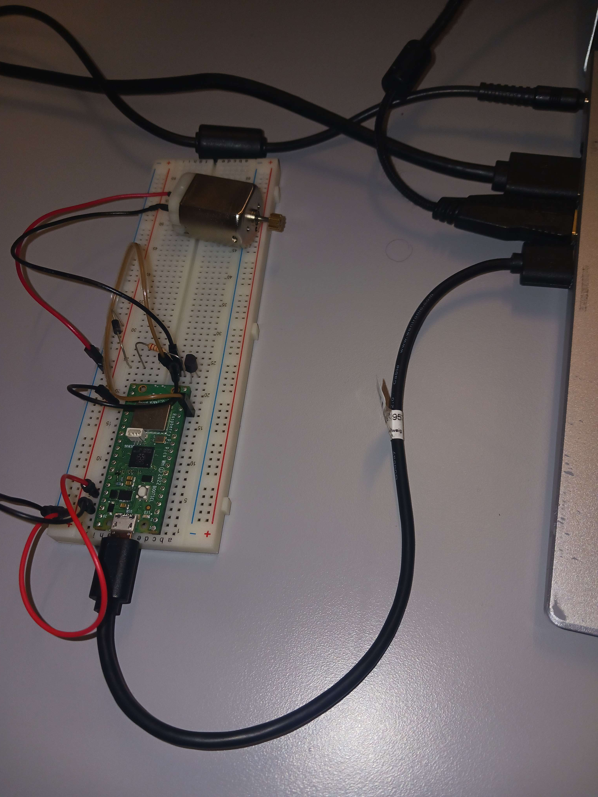
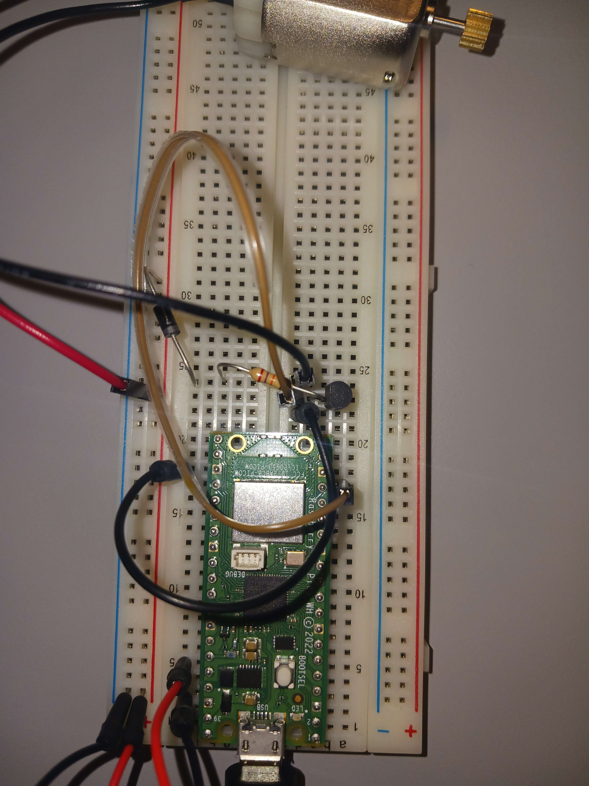
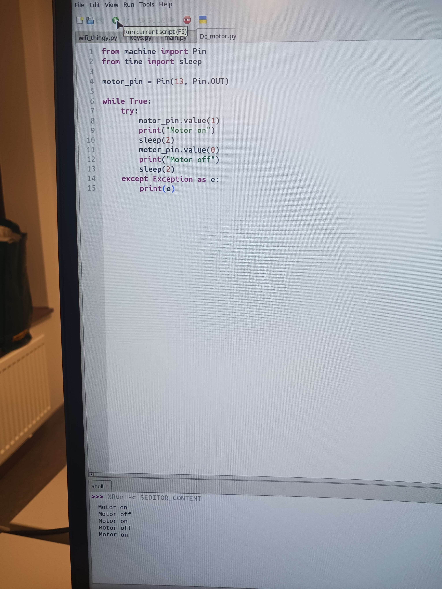

# Experiment 1.1

Using code and breadboard layout reused from Samuel's a3 in Reliability in ES, we got a motor up and running.

[Test code](https://gitlab.lnu.se/nc222iw/droneproject/-/tree/ef9c818b849f3b65102d6f84a61765c75ae1e793/src/tests/test1)

Result: This simple segment from previous assignments can successfully control a DC motor from a RPI Pico.

Overview of board state

Overview of board wiring during test 1

Simple code for testing during test 1
