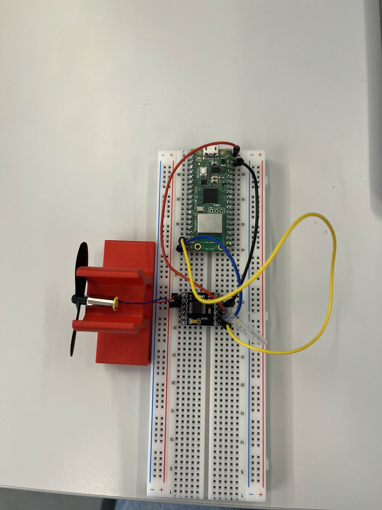

# Experiment 2.2

Having now received the DRV8833 motor drivers, they were tested in combination with the RPI Pico W and a motor.
Sample code found at; [https://github.com/AHSPC/DRV8833_micropython/tree/main]

[Test code](https://gitlab.lnu.se/nc222iw/droneproject/-/blob/8cc324f52cf0a6d1732ce660157fe8466515f12f/src/tests/drv8833_test.py)

Result: *"The DRV8833 proved to work, problem; the contact surface to the motor seems to affect the power supply to the motor"*

Overview of board state
