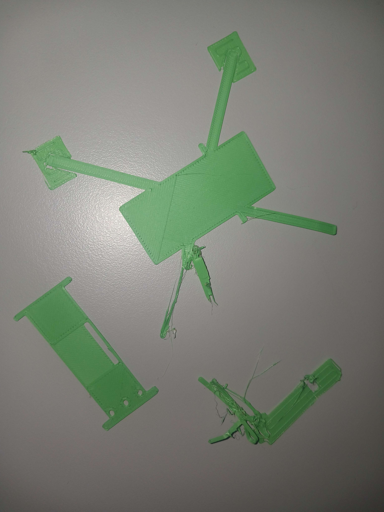
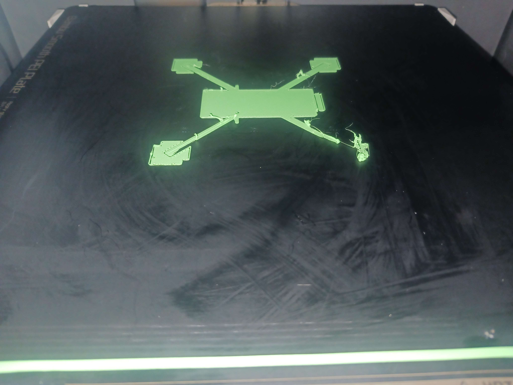
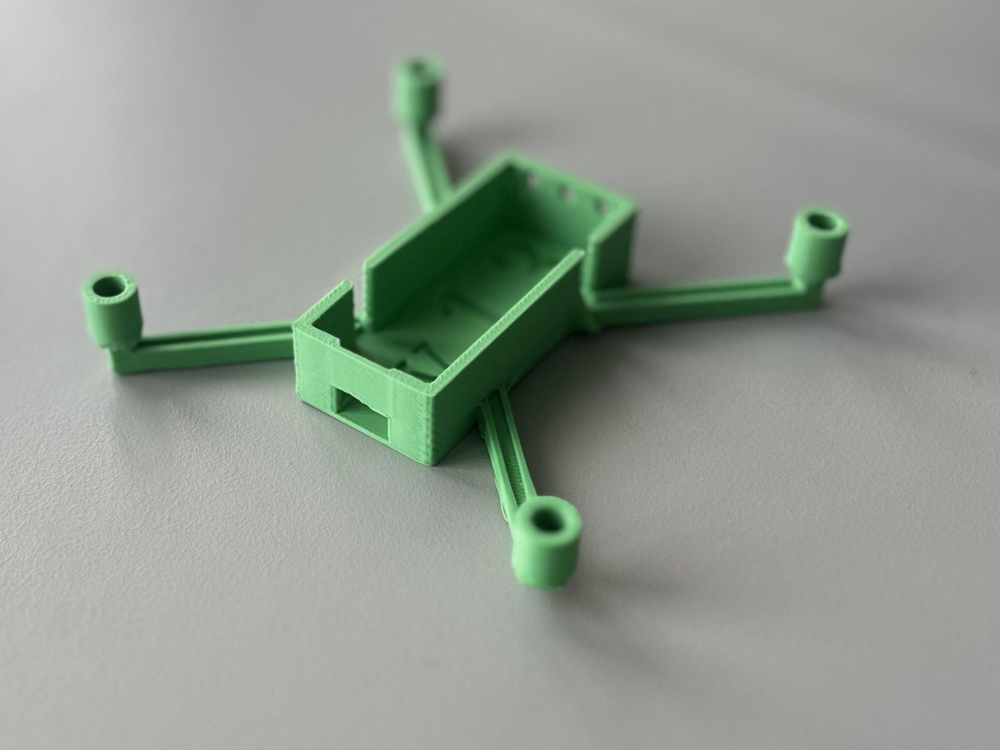
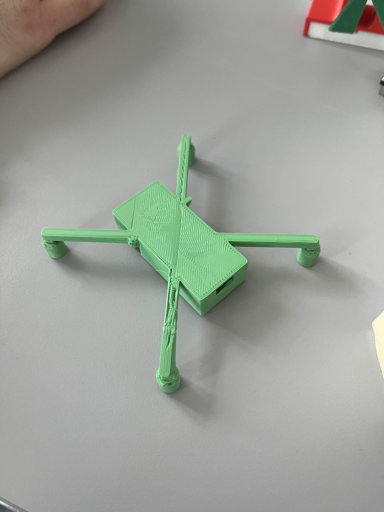
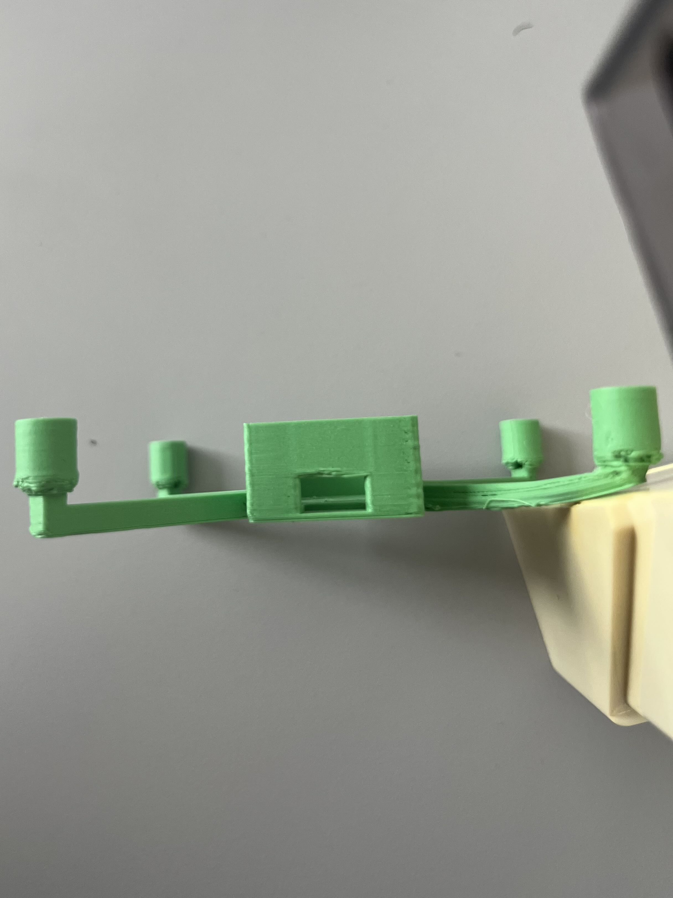
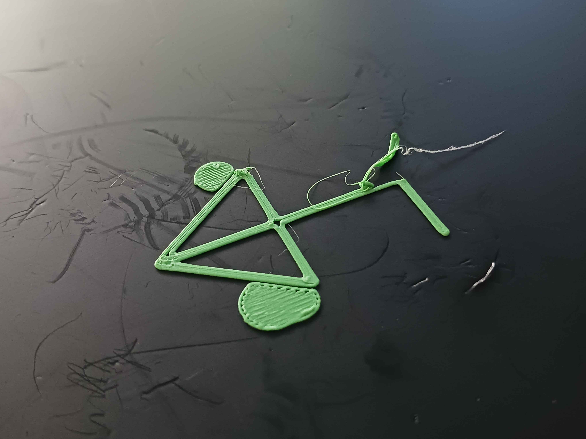
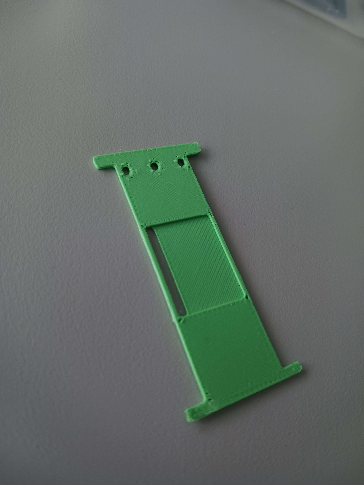

# Experiment 3.0 Chassis prototype: Alpha

Based on revisions of the chassis drafts v1.1-v1.2, v1.3 was made, and after a series of failures we got an acceptable print.

Issues;

* Edge warping and plate detachement in thinner parts of the models.
* Excessive stringing.
* Incompatible 3d-printer setting faults.
* Underestimated margins for hardware installation.

Attempt 2 at printing v1.3; Excessive stringing and build plate adhesion issues.

Attempt 3 at printing v1.3; Printed only body, print bed adhesion issues still caused a print fail.

## Result

After inplementing a series of fixes and proper slicing adjustments, as per below, a functional (but not without errors) prototype was finally printed.

Fixes;

* Set proper settings in Slicing software
  * Smooth PEI plate
  * 1,75 mm PLA
  * 0.4mm nozzle ø
  * 0.2mm layer height
  * 0.4mm starting layer height
* Simplified drone arm shape
* Printed chassis in sections (lid/body/battery cage)

This gave us a prototype good enough to analyse, and design a Beta version off of. The body section was weighed to 10g.

Note: some build plate adhesion issues remain to be solved, but we already got a great improvement. Primary analysis of prototype Alpha is;

* Lid is too thin
* Too little margin for installing motors and MCU in the body
* Try reduce model complexity (to increase printability)
* Cage needs additional support for printability.
