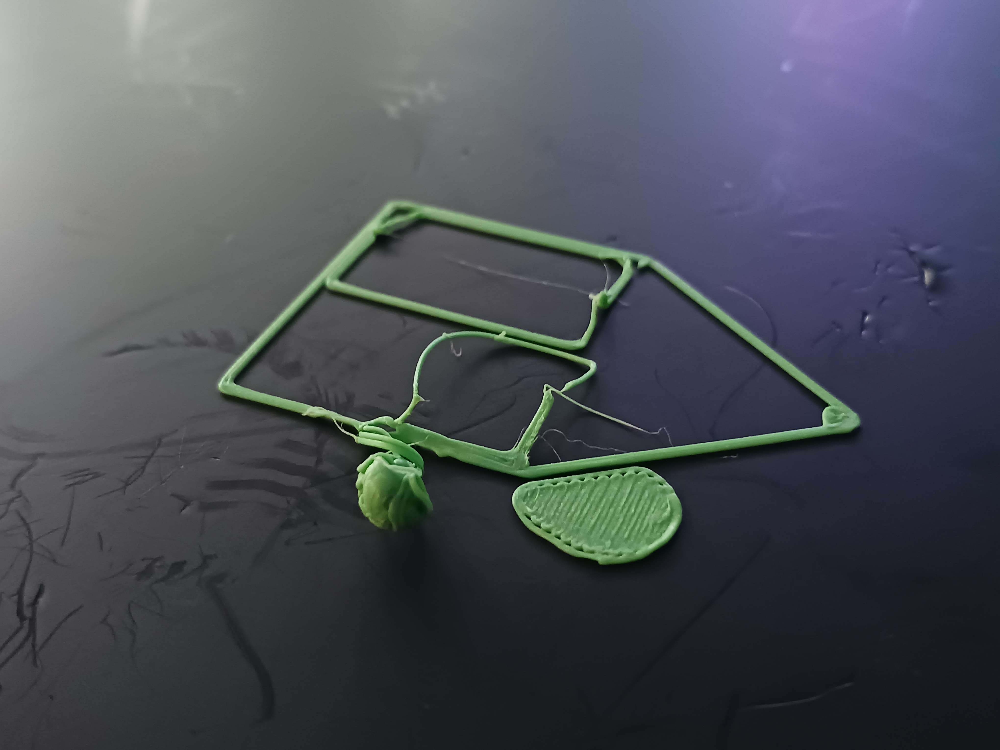
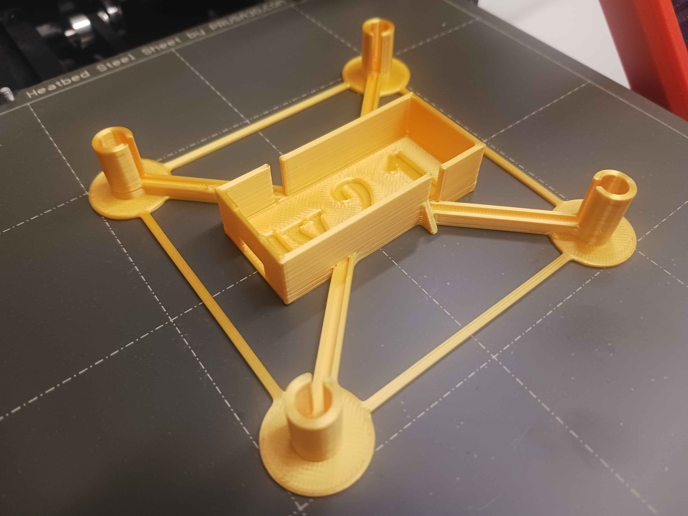
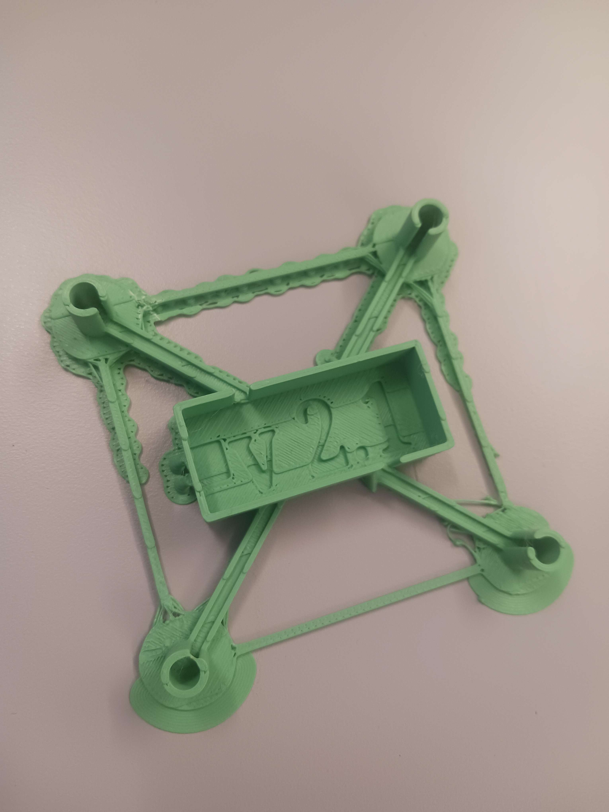
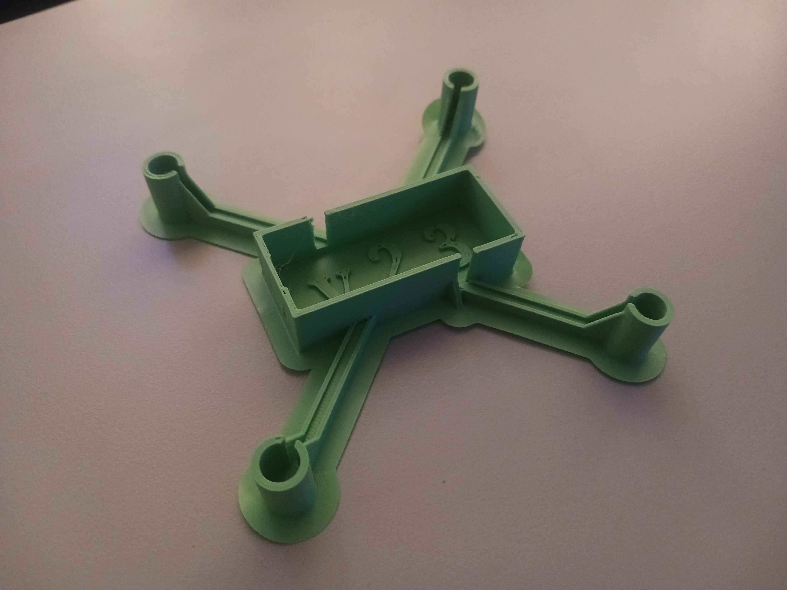

# Experiment 3.0 Chassis prototype: Alpha

Thanks to the basic prototype v1.3 that successfullly printed, we could get enough insights to do a larger redesign of chassis. Many measurements for components proved to be too snug, and the printing issues persisted.

First attempt at v2.1 body that didn't string by the second printing layer. (Too brittle)

Second attempt at v2.1 body, returning to the less brittle PLA. Accidentally sliced the model slightly inclined.

## Result

After inplementing a series of fixes and proper slicing adjustments, as per below, a [functional beta v2.3 prototype](../chassi_revisions/Beta%20v2_3%20body.stl) was FINALLY printed successfully on (surpricingly) the Prusa Mini;

Fixes;

* Set proper settings in Slicing software (Pruse Slicer)
  * Smooth PEI plate
  * 1,75 mm PLA (matte green)
  * 0.4mm nozzle ø
  * 0.2mm layer height
* Simplified drone body shape
* Slight size adjustments to measurements of the body
  * Propeller holders too snug
  * Micro usb port hole too low
  * Case floor too thick
  * Propeller holders got more support to the arms

This gave us a prototype where our hardware components finally fit properly, without being too brittle or having printing errors. Beta v2.3 cage and lid still remain to be printed.

